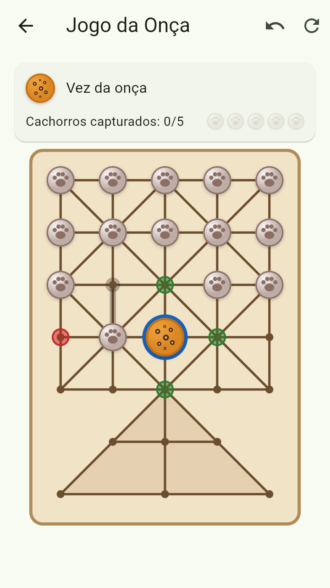

# Jogos de Tabuleiro

> Este repositório também tem dois jogos de plataforma em HTML5:
> **A Fortaleza de Areia** ([`fortaleza/`](fortaleza/README.md)) e
> **Chasqui: O Caminho do Sol** ([`chasqui/`](chasqui/README.md)).

App Flutter (Android e iOS) com jogos de tabuleiro clássicos. O primeiro é o
**Jogo da Onça**. A interface usa `CustomPainter` e widgets animados, sem
motor de jogos.



## Como rodar

Requisitos: Flutter 3.27 ou mais recente (Dart 3.6 ou mais recente).

```bash
flutter pub get
```

```bash
flutter run
```

```bash
flutter analyze
```

```bash
flutter test
```

As traduções ficam em `lib/l10n/app_pt.arb`. O código gerado
(`lib/l10n/gen/`) está versionado. Depois de editar o ARB, regenere com:

```bash
flutter gen-l10n
```

Para simular partidas IA × IA em todos os níveis (útil ao ajustar a
heurística):

```bash
dart run tool/simulate.dart 4
```

## Arquitetura

```
lib/
├── engine/   Motor genérico (Dart puro): grafo do tabuleiro, peças, estado
│             imutável, lances, resultado, sessão com histórico/desfazer.
├── games/    Regras de cada jogo (Dart puro) + catálogo de jogos.
│   └── onca/ Geometria, configuração, regras e avaliação heurística.
├── ai/       IA genérica: minimax + alfa-beta, níveis, execução em isolate.
├── ui/       Telas, widgets e controller (sem regras de jogo).
└── l10n/     Textos (pt) e código gerado.
```

- **`engine/`**: `BoardGraph` descreve o tabuleiro como pontos e *linhas
  retas*. A adjacência e os saltos (capturas) derivam das linhas.
  `GameState` é imutável. `GameRules` é a interface que cada jogo implementa.
  `GameSession` guarda o histórico, desfaz lances e detecta repetição.
- **`ai/`**: `MinimaxAi` funciona com qualquer `GameRules` mais um
  `Evaluator` específico do jogo. A busca trata capturas encadeadas
  (o mesmo jogador joga de novo) e tem quiescência para capturas. Os níveis
  (`Difficulty`) definem a profundidade e um ruído aleatório.
  `computeAiMove` roda a busca em um isolate com `Isolate.run`.
- **`ui/`**: `GameController` (`ChangeNotifier`) traduz toques em lances e
  dispara a IA. `BoardView` desenha qualquer `BoardGraph`.
- Um teste (`test/engine/pure_dart_test.dart`) garante que `engine`,
  `games` e `ai` não importam Flutter.

### Gerenciamento de estado: `ChangeNotifier`

Escolhemos `ChangeNotifier`/`ListenableBuilder`, nativos do Flutter, em vez
de Riverpod. O estado de UI é pequeno e local a cada tela (seleção,
destaques, "IA pensando"). Todo o resto vive no motor imutável. Assim não há
dependência extra nem conceitos a mais. Se o app crescer (perfis,
estatísticas, configurações globais), o controller pode ser exposto por um
provider sem mexer nas regras.

## Regras do Jogo da Onça

Ver [docs/regras-onca.md](docs/regras-onca.md), que lista a geometria do
tabuleiro e as decisões sobre regras ambíguas.

## Como adicionar um novo jogo

1. **Tabuleiro**: em `lib/games/<jogo>/<jogo>_board.dart`, crie o
   `BoardGraph` com os pontos (ids `0..n-1` e coordenadas para desenho) e as
   linhas retas. Escreva um teste que confira o número de pontos e de
   ligações.
2. **Regras**: implemente `GameRules` (`initialState`, `legalMoves`,
   `apply`, `outcome`, `repetitionDrawCount`) em Dart puro e sem estado
   mutável, para poder ir ao isolate. Use os lances do motor (`StepMove`,
   `CaptureMove`, `EndChainMove`) ou crie novos subtipos de `Move`, por
   exemplo uma colocação na Trilha. Se o jogo precisar de dados extras no
   estado (peças na mão), use `GameState.extra` ou estenda `GameState`.
3. **IA**: implemente `Evaluator` com uma heurística do jogo. Os níveis e a
   execução em isolate já funcionam.
4. **Testes**: cubra geração de lances, capturas, fim de partida e uma
   partida IA × IA (veja `test/ai/ai_vs_ai_test.dart`).
5. **Catálogo**: marque o jogo como `available: true` em
   `lib/games/game_catalog.dart`.
6. **UI**: crie as telas de configuração e de jogo em `lib/ui/screens/`,
   reutilizando `BoardView` e `GameController`, e abra-as no `switch` de
   `HomeScreen._open`. Acrescente os tipos de peça em `PieceView`.
7. **Textos**: adicione as strings em `lib/l10n/app_pt.arb` e rode
   `flutter gen-l10n`.
